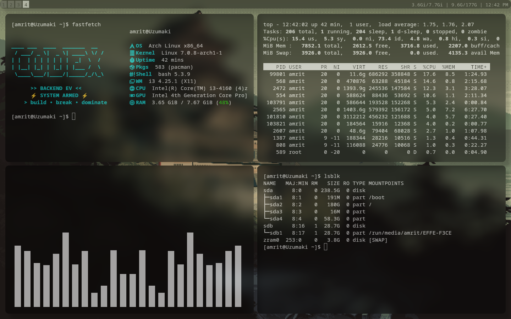

<div align="center">


</div>

---

## About

A lazy person's i3wm setup — built to be **light enough that it doesn't need a status bar plugin, a compositor with a hundred effects, or a heavy DE riding along in the background.** Everything here is picked because it's small, fast, and does exactly one job well.

## Screenshots

<p align="center">
  
  
</p>

---

## Packages

Install everything in one go — `yay` handles both official repo and AUR packages, so this covers all of it:

```bash
yay -S i3wm rofi kitty picom dunst pipewire wireplumber thunar scrot gammastep xwallpaper zed legcord
```

If got no yay no problem we go with pacman:

```bash
pacman -S i3wm rofi kitty picom dunst pipewire wireplumber thunar scrot gammastep xwallpaper zed legcord
```

Note :- please don't make me shamful for a tiny thing like sudo if you are not root just go root or sudo it 

| Package | What it's for |
|---|---|
| **i3wm** | The window manager itself — uses the **built-in i3bar** for the status bar, no polybar/waybar needed. This is the main reason the whole setup stays this light. |
| **rofi** | App launcher / menu |
| **kitty** | Terminal emulator |
| **picom** | Compositor — handles transparency and screen-tearing fixes |
| **dunst** | Notification daemon |
| **pipewire** + **wireplumber** | Audio server + the `wpctl` command used for volume control |
| **thunar** | File manager — **not a hard requirement**, swap in whatever file manager you like |
| **scrot** | Screenshots |
| **gammastep** | Screen color temperature / warmth control |
| **xwallpaper** | Sets the wallpaper |
| **zed** | Code editor |
| **legcord** | Discord client — works well, but I'm not 100% sold it's the *best* option out there, so feel free to swap it |

> Note: package names above are correct at time of writing — always sanity-check with `yay -Ss <name>` if something doesn't resolve, package names occasionally change.

---

## Features & Keybinds

**No status bar plugin needed.** The config leans on i3's own built-in i3bar instead of something like polybar — one less background process, one less thing to configure, and it's plenty for a minimal setup.

**Brightness control (even on monitors that don't support it).** Some displays don't expose real hardware brightness control. Instead of skipping that feature, `brightness.sh` fakes it by dimming the screen with a dark overlay — works everywhere, no hardware dependency. Adjust the dim strength directly inside `brightness.sh`.

**Warm mode via gammastep:**
```
bindsym $mod+control+d exec gammastep -O 5000
```
`-O` sets a one-shot color temperature in Kelvin — lower numbers (e.g. `3500`) are warmer/redder, higher numbers are cooler/bluer. Change the `5000` to whatever temperature suits you, or bind a couple of different values to different keys if you want quick presets.

**Wallpaper (via `xwallpaper`).** If you're using the `wallshift.sh` fade-cycler script alongside this, wallpapers are pulled from a folder set at the top of the script:
```bash
WALLPAPER_DIR="${WALLSHIFT_DIR:-$HOME/Pictures/wallpapers}"
```
Change that path (or export `WALLSHIFT_DIR` before running it) to point at your own wallpaper folder — no other edits needed.

**Screenshots (`scrot`) and volume (`wpctl`)** are both bound inside the i3 config — check `~/.config/i3/config` for the exact `bindsym` lines and adjust keys/save paths to your liking.

---

## Installation

```bash
git clone https://github.com/lazzy-amrit/my-dotfiles.git
cd <my-dotfiles>
```

Then symlink or copy the folders you want into `~/.config/`, install the packages above, and restart i3 (`$mod+Shift+r`) to load everything.

---

<div align="center">

Made by someone too lazy to run a heavy DE — and that's the whole point.

</div>
